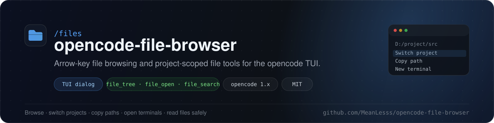
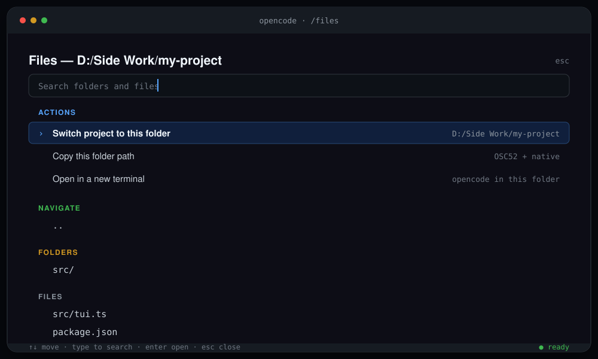

<p align="center">
  
</p>

<h1 align="center">opencode-file-browser</h1>

<p align="center">
  A fast, keyboard-first file browser for the <strong>opencode</strong> terminal UI —
  plus three project-scoped file tools for the agent.
</p>

<p align="center">
  <a href="https://github.com/MeanLesss/opencode-file-browser/actions/workflows/ci.yml"></a>
  <a href="https://github.com/MeanLesss/opencode-file-browser/stargazers"></a>
  <a href="https://github.com/MeanLesss/opencode-file-browser/commits/main"></a>
  <a href="./LICENSE"></a>
  
  
</p>

<p align="center">
  <a href="#install">Install</a> ·
  <a href="#usage">Usage</a> ·
  <a href="#agent-tools">Agent tools</a> ·
  <a href="#troubleshooting">Troubleshooting</a> ·
  <a href="#contributing">Contributing</a>
</p>

---

## Why this plugin

- **No mouse, no typing paths.** Open `/files`, use the arrow keys, and press
  `Enter`.
- **Switch projects without restarting.** Move the active session to another
  folder, or open a new one there.
- **Everything stays in the project.** The agent tools resolve paths inside the
  project root and reject `..` escapes.
- **One folder, two halves.** The same plugin adds the TUI dialog and the agent
  tools; no extra services, no build step, no global install.
- **Works where you work.** Windows, macOS, and Linux clipboard and terminal
  fallbacks are built in.

<p align="center">
  
</p>

<p align="center"><sub>Illustration of the <code>/files</code> dialog. Your theme and terminal may look different.</sub></p>

---

## Features

| Feature | What it does |
| --- | --- |
| `/files` dialog | Arrow-key navigation, fuzzy search, folder traversal, file preview. |
| Switch project | Moves the current session to the selected folder; opens a new session from the home screen. |
| Copy path | Copies the folder with OSC52 and a native clipboard fallback. |
| New terminal | Launches a fresh `opencode` in the selected folder. |
| `file_tree` | Project tree with depth and hidden-file controls. |
| `file_open` | Reads text files with binary detection and a size cap. |
| `file_search` | Case-insensitive file-name search with a result cap. |
| Remembered roots | Reopens the last folder you used for each project. |
| Safe by default | Agent tools cannot escape the project root. |

---

## Requirements

| Requirement | Notes |
| --- | --- |
| opencode **1.x** | Built against `@opencode-ai/plugin` 1.19.5. opencode 2.x is not supported. |
| Node.js + npm | Needed once to install the plugin's dependencies. |
| `opencode` on `PATH` | Only for **Open in a new terminal**. Override with `OPENCODE_BIN`. |
| A clipboard tool | Optional. Copy-path falls back to PowerShell/`clip.exe`, `pbcopy`, `wl-copy`, `xclip`, or `xsel`. |

---

## Install

There are two halves, and opencode reads them from different config files:

| Half | Adds | Config file |
| --- | --- | --- |
| Server plugin | `file_tree`, `file_open`, `file_search` | `opencode.json(c)` |
| TUI plugin | `/files` dialog and its actions | `tui.json(c)` |

Point both files at the same plugin folder if you want both halves.

Config locations:

- **Global:** `~/.config/opencode/` — on Windows,
  `C:\Users\<you>\.config\opencode\`.
- **Project:** `opencode.json(c)` and `tui.json(c)` in the project root, or
  inside `.opencode/`.

> Paths must be **absolute** or start with `.` (relative to the config file).
> `~/...` is treated as an npm package name, so expand it manually.

### Quick install (one command)

The installer checks your opencode version, downloads the plugin, installs its
dependencies, and registers both config entries for you.

**Windows (PowerShell):**

```powershell
irm https://raw.githubusercontent.com/MeanLesss/opencode-file-browser/main/install.ps1 | iex
```

**macOS / Linux:**

```sh
curl -fsSL https://raw.githubusercontent.com/MeanLesss/opencode-file-browser/main/install.sh | sh
```

What it does:

1. Detects `opencode --version` and refuses opencode 2.x with a clear message.
2. Clones the repo to `~/opencode-file-browser` when it is not already there.
3. Installs the runtime dependencies (`npm`, or `bun` as a fallback).
4. Runs `opencode plugin <path> -g`, which writes the server entry to
   `opencode.jsonc` and the TUI entry to `tui.json` while preserving existing
   JSONC content.
5. Prints the restart reminder.

Already cloned the repo? Run the script from inside it instead:

```powershell
.\install.ps1
```

```sh
./install.sh
```

Useful options:

| Windows | macOS / Linux | Meaning |
| --- | --- | --- |
| `.\install.ps1 -Project C:\path\to\project` | `./install.sh --project /path/to/project` | Write project configs instead of global configs. |
| `.\install.ps1 -SkipDeps` | `./install.sh --skip-deps` | Skip the dependency install. |
| `.\install.ps1 -NoClone` | `./install.sh --no-clone` | Never clone; fail if the repo is not already present. |

The scripts are short and readable: [install.ps1](./install.ps1),
[install.sh](./install.sh). If you prefer to do it by hand, use the manual
steps below.

Safe to re-run: `opencode plugin` leaves an existing entry untouched, so you can
use the installer to verify or repair an installation.

### Manual install

There are two halves, and opencode reads them from different config files:

| Half | Adds | Config file |
| --- | --- | --- |
| Server plugin | `file_tree`, `file_open`, `file_search` | `opencode.json(c)` |
| TUI plugin | `/files` dialog and its actions | `tui.json(c)` |

Point both files at the same plugin folder if you want both halves.

Config locations:

- **Global:** `~/.config/opencode/` — on Windows,
  `C:\Users\<you>\.config\opencode\`.
- **Project:** `opencode.json(c)` and `tui.json(c)` in the project root, or
  inside `.opencode/`.

> Paths must be **absolute** or start with `.` (relative to the config file).
> `~/...` is treated as an npm package name, so expand it manually.

#### 1. Clone and install dependencies

**Windows (PowerShell):**

```powershell
git clone https://github.com/MeanLesss/opencode-file-browser.git "$HOME\opencode-file-browser"
Set-Location "$HOME\opencode-file-browser"
npm install
```

**macOS / Linux:**

```sh
git clone https://github.com/MeanLesss/opencode-file-browser.git ~/opencode-file-browser
cd ~/opencode-file-browser
npm install
```

Already have the repo? Run `npm install` inside it once.

#### 2. Enable the agent tools

Add the plugin to your global `opencode.jsonc`:

```jsonc
{
  "$schema": "https://opencode.ai/config.json",
  "plugin": ["C:/Users/you/opencode-file-browser"]
}
```

On macOS or Linux use your absolute path, for example
`"/home/you/opencode-file-browser"`.

#### 3. Enable the `/files` dialog

Add the same path to your global `tui.json`:

```jsonc
{
  "$schema": "https://opencode.ai/tui.json",
  "plugin": ["C:/Users/you/opencode-file-browser"]
}
```

#### 4. Restart opencode

Quit opencode completely and start it again. Then type `/files`.

That is the whole install: no environment variables, no build step, no global
npm package.

### Project-local install

Prefer to keep the plugin inside one repository?

```text
my-project/
  .opencode/
    file-browser/        <- this repo, with node_modules installed
    tui.json
  opencode.jsonc
```

`my-project/.opencode/tui.json`:

```jsonc
{
  "$schema": "https://opencode.ai/tui.json",
  "plugin": ["./file-browser"]
}
```

`my-project/opencode.jsonc`:

```jsonc
{
  "$schema": "https://opencode.ai/config.json",
  "plugin": ["./.opencode/file-browser"]
}
```

Relative paths are resolved from the config file that contains them.

### From npm (after publishing)

Once the package is published, opencode can install it on demand:

```jsonc
{
  "plugin": ["opencode-file-browser"]
}
```

The package is **not published yet** — use the local-folder install above.

### Verify the install

1. Restart opencode.
2. Type `/files`; the dialog should open.
3. Ask the agent: “show the project tree”. It should call `file_tree`.

### Updating and uninstalling

```sh
cd /path/to/opencode-file-browser
git pull
npm install
```

Restart opencode after updating.

To uninstall, remove the path from `opencode.jsonc` and `tui.json`, restart
opencode, and delete the folder.

---

## Usage

### Open the browser

Any of these opens the dialog:

- Type `/files` in the prompt.
- Use an alias: `/browse`, `/fb`, or `/file`.
- Press `Ctrl+P` and choose **File browser** (group **File**).

The dialog starts at the current session's directory, or the project directory
on the home screen. The folder you last used is remembered per project.

### Keys

| Key | Action |
| --- | --- |
| `Up` / `Down` | Move the selection |
| `Left` | Go to the parent folder |
| `Right` | Enter the selected folder |
| Type | Fuzzy-search titles and categories |
| `Enter` | On a folder: choose **Navigate**, **Open in a new terminal**, or **Cancel**. On a file: preview it. On an action: run it. |
| `Esc` | Close the dialog, or cancel the folder prompt |

`Left` and `Right` navigate folders when the search box is empty. While you are
typing a query, they keep their normal text-cursor behavior.

The browser opens in the extra-large dialog for more room.

Entries are grouped as **Actions**, **Navigate**, **Folders**, and **Files**.

### Actions in detail

**Switch project to this folder**

- In a session: moves the current session to the selected folder. Local file
  changes stay where they are; the session simply points at the new directory.
- On the home screen, or when the move endpoint is unavailable: opens a new
  session in that folder.
- The selected folder becomes the remembered browser root for the old project.

**Copy this folder path**

- Copies the absolute path with OSC52, then also tries the native clipboard.
- Windows: `Set-Clipboard`, then `clip.exe`.
- macOS: `osascript` / `pbcopy`.
- Linux/Wayland: `wl-copy`; X11: `xclip` or `xsel`.
- If nothing is available, a toast shows the path so you can copy it manually.

**Open in a new terminal**

- Starts a fresh `opencode` in the selected folder.
- Windows: `cmd /c start`.
- macOS: Terminal via `osascript`.
- Linux: the first available of `x-terminal-emulator`, `gnome-terminal`,
  `konsole`, `xterm`.
- Set `OPENCODE_BIN` to use a different executable.

**Folders and files**

- Press `Right` on a folder to enter it directly.
- Press `Enter` on a folder to choose:
  - **Navigate into folder** — open it in the browser.
  - **Open in a new terminal** — start a fresh `opencode` there.
  - **Cancel** — stay where you are.
- Press `Left` to go back to the parent folder.
- Files show a preview dialog. Binary files are labelled; text is capped at
  80 KB. Closing the preview returns to the same folder.

---

## Agent tools

Ask the agent naturally, or call the tools directly.

| Tool | Arguments | Behavior |
| --- | --- | --- |
| `file_tree` | `path?`, `depth?` (default `"3"`, max `10`), `showHidden?` | Prints the project tree from the project root. |
| `file_open` | `path` (required) | Returns file text; detects binary files; truncates at 80 KB. |
| `file_search` | `query` (required), `path?`, `showHidden?` | Case-insensitive file-name search, capped at 200 results. |

Example prompts:

```text
show the project tree
list src two levels deep, including hidden files
open package.json
show me src/tui.ts
find files named config
search for tui in src
```

All tool paths are resolved inside the project root (`worktree` in a git repo,
otherwise `directory`). Paths that try to escape with `..` are rejected.

---

## Security and scope

- Agent tools cannot read outside the project root.
- The TUI browser itself can browse any readable directory, because you choose
  folders manually.
- “Switch project” changes the session's working directory; it does not copy,
  delete, or move files.
- The plugin only reads the filesystem, writes to the clipboard, and launches a
  terminal. Nothing is sent anywhere.

---

## Troubleshooting

| Problem | Fix |
| --- | --- |
| `/files` does not appear | The TUI half goes in `tui.json`, not only `opencode.jsonc`. Check the path is absolute or starts with `.`. Restart opencode. |
| Agent tools are missing | Add the plugin to `opencode.json(c)` too; that file controls server plugins. |
| Installer says “Could not run opencode --version” | Run it from a shell where `opencode --version` works, or install opencode 1.x and reopen the terminal. |
| Installer says the folder already exists | The default clone location `~/opencode-file-browser` exists but is not this repo. Move it, or clone elsewhere and run the installer from there. |
| Two copies of the plugin are installed | Remove the old path from `opencode.jsonc` and `tui.json`; duplicate plugin ids make one copy fail to load. |
| PowerShell blocks `.\install.ps1` | Use the one-line install, or run `Set-ExecutionPolicy -Scope Process Bypass` in that window first. |
| `Could not switch to ...` | Make sure the folder exists and is readable. Older builds fall back to opening a new session. |
| Copy says “Clipboard unavailable” | Install a clipboard tool, or copy the path from the toast. |
| New terminal does not open | Put `opencode` on `PATH`, or set `OPENCODE_BIN`. |
| Plugin fails to load | Run `npm install` in the plugin folder and check `~/.local/share/opencode/log/opencode.log` for `[tui.plugin]` lines. |
| JSON path errors on Windows | Escape backslashes (`"D:\\tools\\plugin"`) or use forward slashes (`"D:/tools/plugin"`). |

---

## How it works

```text
src/index.ts   server half: file_tree, file_open, file_search
src/tui.ts     TUI half: /files dialog and actions
```

`package.json` exposes the two entry points as `./server` and `./tui`, which is
what opencode loads. The browser remembers the last folder per project through
opencode's key-value storage. Session switches use opencode's control-plane move
endpoint and fall back to creating a new session in the target folder.

### Development

```sh
npm install
npm run typecheck
```

To test changes in a real opencode instance, point both config files at this
folder and restart opencode.

---

## Roadmap

- Publish to npm for one-line installs.
- Syntax-highlighted file previews.
- Optional configurable keybindings.
- More file actions (rename, delete, create).

Have an idea? Open an issue — small, focused suggestions are easiest to ship.

---

## Contributing

Contributions are welcome. Please:

1. Fork the repo and create a branch.
2. Keep changes focused and update the README if behavior changes.
3. Run `npm run typecheck`.
4. Open a pull request describing the problem and the fix.

See [CONTRIBUTING.md](./CONTRIBUTING.md) for the full setup and review notes.

---

## Support the project

If this plugin saves you time, a star helps other opencode users find it.
Questions and ideas are welcome in
[Discussions](https://github.com/MeanLesss/opencode-file-browser/discussions),
and bugs belong in [Issues](https://github.com/MeanLesss/opencode-file-browser/issues).

<a href="https://github.com/MeanLesss/opencode-file-browser/stargazers">
  
</a>

---

## Disclaimer

This software is provided **"AS IS"**, free of charge, for professional and
personal use. It is released under the MIT license, which carries no warranty
of any kind. **The author and contributors accept no responsibility or
liability for any harm, loss, data corruption, or damage** arising from the use
of this software, to the fullest extent permitted by law. Use at your own risk.

## License

[MIT](./LICENSE)
